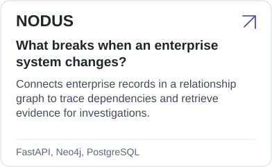
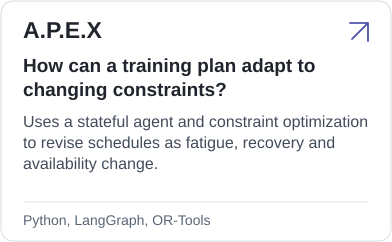
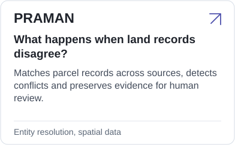
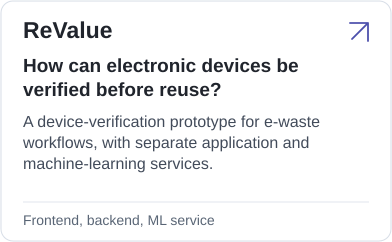
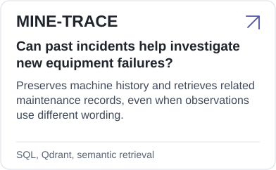
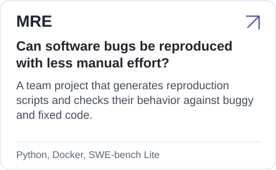
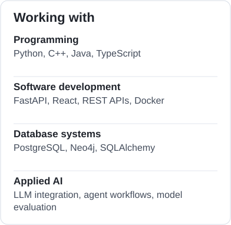
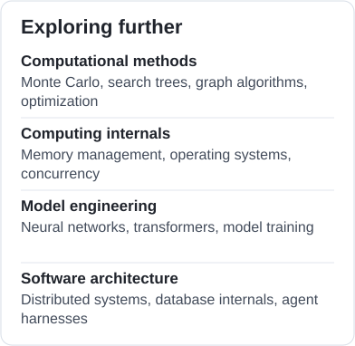

<picture><source media="(prefers-color-scheme: dark)" srcset="assets/hero.svg"><source media="(prefers-color-scheme: light)" srcset="assets/hero-light.svg"></picture>

[Projects](#selected-projects) · [Technical background](#technical-background) · [Reading & interests](#beyond-projects)

## Selected projects

### Intelligent systems

  <a href="https://github.com/Glassman007/NODUS"><picture><source media="(prefers-color-scheme: dark)" srcset="assets/nodus.svg"><source media="(prefers-color-scheme: light)" srcset="assets/nodus-light.svg"></picture></a>
  <a href="https://github.com/Glassman007/A.P.E.X"><picture><source media="(prefers-color-scheme: dark)" srcset="assets/apex.svg"><source media="(prefers-color-scheme: light)" srcset="assets/apex-light.svg"></picture></a>

### Data integrity & verification

  <a href="https://github.com/Glassman007/PRAMAN"><picture><source media="(prefers-color-scheme: dark)" srcset="assets/praman.svg"><source media="(prefers-color-scheme: light)" srcset="assets/praman-light.svg"></picture></a>
  <a href="https://github.com/Glassman007/ReValue"><picture><source media="(prefers-color-scheme: dark)" srcset="assets/revalue.svg"><source media="(prefers-color-scheme: light)" srcset="assets/revalue-light.svg"></picture></a>

### Software reliability & developer tools

  <a href="https://github.com/Glassman007/MINE-TRACE"><picture><source media="(prefers-color-scheme: dark)" srcset="assets/mine-trace.svg"><source media="(prefers-color-scheme: light)" srcset="assets/mine-trace-light.svg"></picture></a>
  <a href="https://github.com/garvitsingh006/MRE"><picture><source media="(prefers-color-scheme: dark)" srcset="assets/mre.svg"><source media="(prefers-color-scheme: light)" srcset="assets/mre-light.svg"></picture></a>

[Project notes](dossier/project-casebook.md) — architecture, limitations and tests I would run next.

## Technical background

  <picture><source media="(prefers-color-scheme: dark)" srcset="assets/working-with.svg"><source media="(prefers-color-scheme: light)" srcset="assets/working-with-light.svg"></picture>
  <picture><source media="(prefers-color-scheme: dark)" srcset="assets/exploring-further.svg"><source media="(prefers-color-scheme: light)" srcset="assets/exploring-further-light.svg"></picture>

## Beyond projects

### Reading & learning

I prefer learning from books, technical documentation and source code, then implementing the concepts myself. A few books on my reading list:

- [Think Python](https://allendowney.github.io/ThinkPython/) — Allen B. Downey
- [Understanding Deep Learning](https://udlbook.github.io/udlbook/) — Simon J. D. Prince
- [Problem Solving with Algorithms and Data Structures](https://runestone.academy/ns/books/published/pythonds3/index.html) — Bradley N. Miller and David L. Ranum

[Study notes and proposed experiments](dossier/engineering-notebook.md)

### How I approach engineering

I prefer understanding why a solution works before relying on it. I'm interested in the trade-offs between simplicity, performance and reliability, and in knowing when a problem needs a sophisticated solution and when it doesn't.

### Open source

I'd like to contribute to open-source developer tools, database systems, machine learning infrastructure and agent frameworks.

## Links

[LinkedIn](https://www.linkedin.com/in/aditya-karki-03062830b/) / [Email](mailto:simplyadityakarki@gmail.com) / [All repositories](https://github.com/Glassman007?tab=repositories)

<!-- Add the public Resume and Personal website URLs here when available. -->
