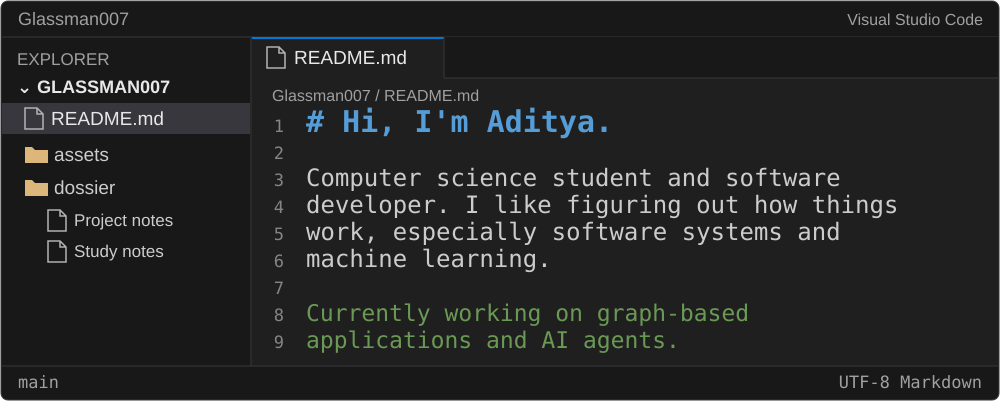
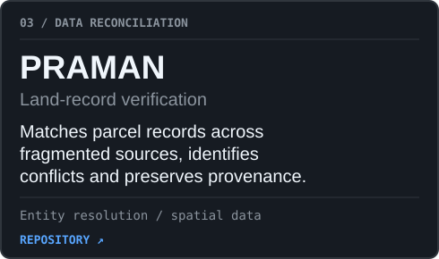
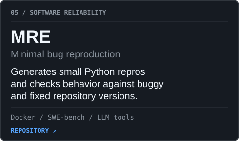

[Projects](#projects) / [Tools](#tools-i-work-with) / [Study notes](dossier/engineering-notebook.md) / [All repositories](https://github.com/Glassman007?tab=repositories)

Lately I've been working on graph-based applications and AI agents. I'm particularly interested in what happens when you connect a model to real software: how it retrieves information, how it uses tools, and how you can test whether the result is right.

I also enjoy building things outside AI. My projects include a land-record reconciliation tool, a transaction monitoring dashboard and a local drawing canvas.

## Projects

NODUS is my main graph-based project. It combines a Neo4j relationship graph with scoped retrieval and Gemini-assisted reporting. The demo uses synthetic enterprise data. I'm interested in testing what happens when records are incomplete or a user cannot access a relevant source. [More about NODUS](dossier/project-casebook.md#nodus).

A few other things I've worked on:

- [ReValue](https://github.com/Glassman007/ReValue) — a device-verification prototype for e-waste workflows, with a separate ML service.
- [Pipeline Explorer](https://github.com/Glassman007/Pipeline-Explorer) — inspect transaction events and fraud-scoring rules.
- [MindMap](https://github.com/Glassman007/MindMap) — a local-first canvas for drawing and organizing ideas manually.

[More about the projects](dossier/project-casebook.md) — architecture, design decisions and what still needs testing.

## Tools I work with

**Languages:** Python, C++, Java, JavaScript, TypeScript and SQL.

**Backend and data:** FastAPI, Pydantic, PostgreSQL, Neo4j, Qdrant, React and Node.js.

**AI and testing:** Gemini, LangGraph, OR-Tools, Pytest and Playwright.

**Development:** Git, Docker, Docker Compose, Alembic and Railway.

## What I'm learning

I'm studying data structures, operating systems and the internals of databases, alongside machine learning. I've completed Andrew Ng's Machine Learning Specialization and am working toward implementing and training a small language model myself using PyTorch.

One question I keep coming back to is how to make AI-assisted software testable. For example, in MRE, a generated reproduction has to fail on the buggy code and pass on the fixed version; a convincing explanation alone isn't enough.

[Study notes and experiments I want to try](dossier/engineering-notebook.md)

[Browse all repositories](https://github.com/Glassman007?tab=repositories)
