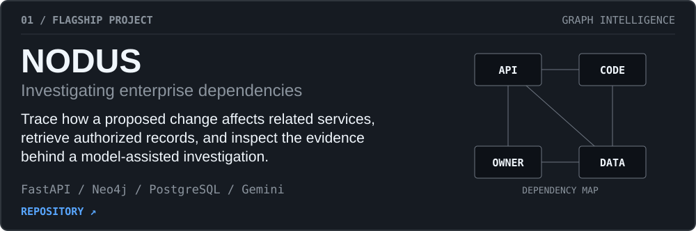
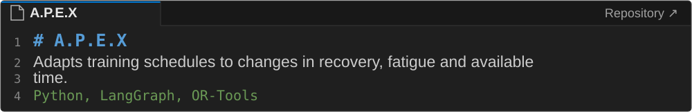
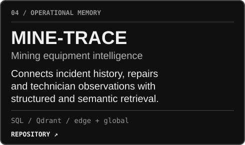

  

  <a href="#about">About</a> &nbsp; / &nbsp;
  <a href="#selected-work">Projects</a> &nbsp; / &nbsp;
  <a href="#technical-toolkit">Toolkit</a> &nbsp; / &nbsp;
  <a href="#engineering-practice">Practice</a> &nbsp; / &nbsp;
  <a href="#current-direction">Direction</a>

## About

I'm a computer science student and software developer interested in how intelligent applications behave beyond the model itself: how information is stored, how decisions are made, and how those decisions can be checked. My projects range from enterprise dependency graphs and land-record reconciliation to adaptive planning, incident memory and automated software testing.

I am developing depth in both **software and systems engineering** and **AI/model engineering**. I approach new problems through small implementations, documentation, testing and iteration rather than treating a successful demo as proof that a system is reliable.

| Area | What I work on |
| :--- | :--- |
| **Software & systems** | Backend services, relational and graph data, API contracts, state management and deployment. |
| **AI & agent engineering** | Model-assisted retrieval, structured decisions, planning loops and verification harnesses. |
| **Applied data & trust** | Reconciliation, transaction monitoring, semantic search, evidence provenance and auditability. |

---

## Selected work

These projects explore a shared question: **how can software turn incomplete or scattered information into decisions that can be inspected and tested?** Each uses a different combination of data modeling, retrieval, automation and verification.

NODUS combines structured relationships with model-assisted investigation. The prototype demonstrates graph exploration and generated reports on synthetic enterprise records; rigorous claim-level evidence checks and automatic task routing remain areas to validate. [Read the case summary](dossier/project-casebook.md#01--nodus).

  
  

  
  

### Additional projects

| Project | Introduction | Engineering focus |
| :--- | :--- | :--- |
| [**ReValue**](https://github.com/Glassman007/ReValue) | Device verification in the e-waste ecosystem. | Separation of frontend, backend and ML service; evidence-driven verification design. |
| [**Pipeline Explorer**](https://github.com/Glassman007/Pipeline-Explorer) | A transaction-monitoring tool for inspecting pipeline behavior and fraud-scoring rules. | Event consumption, rule-based scoring, database schema and dashboard. |
| [**MindMap**](https://github.com/Glassman007/MindMap) | A local-first canvas for free-form visual thinking, without forced layout or automatic connections. | Manual interaction, local persistence, undo/redo and image export. |

**[Project casebook — problem, architecture, limitations and next steps →](dossier/project-casebook.md)**

---

## Technical toolkit

Tools are grouped by how I use or study them, not by self-assigned proficiency scores.

| Layer | Tools & concepts |
| :--- | :--- |
| Programming | Python, C++, Java, JavaScript, TypeScript, SQL |
| Application engineering | FastAPI, Pydantic, React, Node.js, REST APIs |
| Data systems | PostgreSQL, Neo4j, Qdrant, relational schemas, graph traversal, vector retrieval |
| AI systems | Gemini integration, LangGraph, structured outputs, tool orchestration, model evaluation |
| Optimization & validation | OR-Tools, Pytest, Docker-based verification, integration and regression testing |
| Delivery & tooling | Git, Docker, Docker Compose, Alembic, Playwright, Railway |
| Developing depth | PyTorch, numerical computing, deep learning, operating systems, concurrency and distributed systems |

---

## Engineering practice

I am particularly interested in the boundary between **probabilistic reasoning and deterministic software**. The following principles guide the systems I build and the experiments I want to run:

| Principle | What it means in practice |
| :--- | :--- |
| **Trace decisions to evidence** | Keep source records and identifiers accessible instead of accepting a fluent model response as proof. |
| **Separate reasoning from validation** | Use models to propose or interpret; use explicit checks for constraints and acceptance criteria. |
| **Preserve state deliberately** | Treat history, schema design and lifecycle transitions as core parts of an application. |
| **Test failure paths** | Account for incomplete records, invalid output, interrupted writes and unavailable providers. |

**[Engineering notebook — design decisions and study roadmap →](dossier/engineering-notebook.md)**

---

## Current direction

I am pursuing two complementary tracks: understanding computing systems in depth and learning to build and evaluate models independently.

| Track | Next learning objectives |
| :--- | :--- |
| **Systems engineering** | Execution semantics, data structures, debugging, operating systems, database internals and distributed-system design. |
| **ML/model engineering** | Numerical foundations, PyTorch training workflows, model evaluation, transformer implementation and adaptation of open-weight models. |
| **Agent & harness engineering** | Reproducible evaluations, reliable tool use, stateful workflows and failure-aware orchestration. |

I have completed the Andrew Ng Machine Learning Specialization and am continuing with implementation-focused study of machine learning and computing fundamentals.

---

## Connect

I am interested in discussing software architecture, intelligent systems, data infrastructure and practical evaluation problems.

[GitHub profile](https://github.com/Glassman007) &nbsp; / &nbsp; [All repositories](https://github.com/Glassman007?tab=repositories) &nbsp; / &nbsp; [Project casebook](dossier/project-casebook.md) &nbsp; / &nbsp; [Engineering notebook](dossier/engineering-notebook.md)

GLASSMAN007 / ENGINEERING DOSSIER
